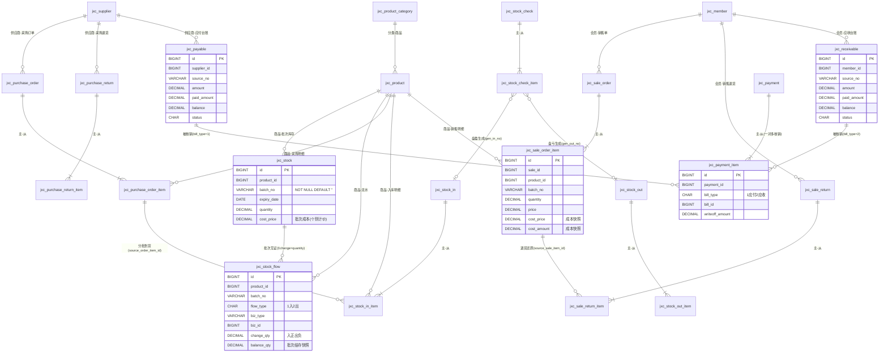

# 中小型商超进销存系统 · 数据库设计说明书

> 对应 SQL：`sql/jxc_schema.sql`（建库建表）、`sql/jxc_data_init.sql`（基础数据与字典）
> 数据库：MySQL 8.0.42 ｜ 引擎 InnoDB ｜ 字符集 utf8mb4 / utf8mb4_general_ci ｜ 库名 **ry_jxc**（新建库，RuoYi 原生 15 张 sys_* 表保持原样不动）
> 业务表统一前缀 `jxc_`，共 **19 个业务实体 / 24 张物理表**（主从单据各拆主表+明细表两张物理表）

---

## 1. 全局设计规范

| # | 规范 | 说明 |
|---|---|---|
| 1 | 主键 | 所有表 `id BIGINT NOT NULL AUTO_INCREMENT PRIMARY KEY` |
| 2 | 审计字段 | 所有表含 `create_by VARCHAR(64)`、`create_time DATETIME`、`update_by VARCHAR(64)`、`update_time DATETIME`、`remark VARCHAR(500)`，对齐 RuoYi 基座 |
| 3 | 精度 | 金额 `DECIMAL(18,2)`，数量 `DECIMAL(18,4)`，单价 `DECIMAL(18,4)`（保证个别计价精度），**全库无 FLOAT/DOUBLE** |
| 4 | 外键策略 | 不使用物理外键，一律逻辑关联，应用层保证引用完整性（对齐 RuoYi 风格） |
| 5 | 单号 | 业务单据单号 `VARCHAR(32) NOT NULL UNIQUE`，规则：前缀+yyyyMMdd+3位流水（PO采购订单 / SI入库 / PR采购退货 / XS销售 / SR销售退货 / CK出库 / PD盘点 / FK付款 / SK收款），Redis 自增保证唯一 |
| 6 | 批次空值 | `jxc_stock.batch_no NOT NULL DEFAULT ''`，非批次商品统一空串，规避 MySQL 唯一索引对 NULL 不去重的陷阱 |
| 7 | 状态字段 | `CHAR(1)` + 注释枚举 + sys_dict_data 字典同步 |
| 8 | 单仓库 | 表结构不设 warehouse_id 维度；不做多计量单位换算 |

## 2. 单据状态机总览

| 单据 | 状态枚举 | 流转规则 |
|---|---|---|
| 采购订单 | 0草稿 1已审核 2部分执行 3已执行 4已作废 | 草稿→已审核→（分批入库推进）部分执行→已执行；**仅草稿可作废**，已执行不可作废 |
| 入库/出库/采购退货/销售退货/盘点/收付款单 | 0草稿 1已审核 2已作废 | **审核即执行**（库存/台账联动发生在审核时刻）；仅草稿可作废，已审单纠错只能开红字/退货单 |
| 销售单（POS） | 0草稿(挂单) 1已审核 2已作废 | **保存即已审核已执行**，一手交钱一手交货 |
| 销售单收款状态 pay_status | 0未收 1部分 2已收 | 现款=已收；赊销生成应收，由收款核销推进 |
| 应收应付核销状态 | 0未核销 1部分核销 2已核销 | paid_amount 累计、balance 递减时联动 |

**核心业务规则（表设计支撑点）**：
1. 库存变动只发生在单据审核时刻；草稿不占用库存，可用量=现存量。
2. 负库存校验以 `jxc_stock` 为唯一依据，原子语句 `UPDATE jxc_stock SET quantity=quantity-? WHERE product_id=? AND batch_no=? AND quantity>=?` + 影响行数判断防并发超扣。
3. 已审核单据不可作废，纠错走红字/退货单。
4. 审核动作与库存变动、成本快照、应收应付生成处于同一事务语义（应用层保证，表结构提供全部写入目标）。
5. 成本核算采用**个别计价法**：`jxc_stock.cost_price` 记批次成本，出库时快照至明细 `cost_price/cost_amount`。
6. 批次商品出库按 **FEFO**（expiry_date 近效期优先）拆批扣减。
7. 核销一对多：`jxc_payment_item` 一笔收付款单核销多张往来单；一张往来单可被多次部分核销。
8. 供应商/会员往来余额由台账 `SUM(balance)` 聚合查询，**不冗余存储**。
9. 临期预警 = `expiry_date − 当前日期 ≤ 阈值`；库存下限预警 = `quantity ≤ stock_min`。
10. 同一事务内完成"单据状态+库存+流水+台账"四处写入，任一失败整体回滚。

---

## 3. 逐表设计说明

> 每张表的字段清单均省略统一审计字段（create_by/create_time/update_by/update_time/remark），实际建表语句中全部包含。

### 3.1 基础资料

#### jxc_product_category 商品分类表
**用途**：商品树形分类，支持父子层级。

| 字段 | 类型 | 约束 | 说明 |
|---|---|---|---|
| id | BIGINT | PK, AUTO_INCREMENT | 分类ID |
| parent_id | BIGINT | NOT NULL DEFAULT 0 | 父分类ID，0 为根 |
| category_name | VARCHAR(64) | NOT NULL | 分类名称 |
| sort | INT | NOT NULL DEFAULT 0 | 显示排序 |
| status | CHAR(1) | NOT NULL DEFAULT '0' | 0正常 1停用 |

| 索引 | 类型 | 用途 |
|---|---|---|
| PRIMARY (id) | 主键 | — |
| idx_parent_id (parent_id) | 普通 | 树形子节点查询 |
| idx_status (status) | 普通 | 有效分类过滤 |

#### jxc_product 商品档案表
**用途**：商品主数据，采购/销售/库存/盘点的商品维度来源。

| 字段 | 类型 | 约束 | 说明 |
|---|---|---|---|
| id | BIGINT | PK | 商品ID |
| category_id | BIGINT | NOT NULL | 逻辑关联 jxc_product_category.id |
| product_code | VARCHAR(32) | NOT NULL UNIQUE | 商品编码 |
| product_name | VARCHAR(128) | NOT NULL | 商品名称 |
| barcode | VARCHAR(64) | NULL | 条码（POS 扫码） |
| unit | VARCHAR(16) | NOT NULL DEFAULT '个' | 计量单位（字典 jxc_product_unit） |
| spec | VARCHAR(64) | NULL | 规格 |
| purchase_price | DECIMAL(18,4) | NOT NULL DEFAULT 0 | 参考进价（实际成本以批次为准） |
| sale_price | DECIMAL(18,4) | NOT NULL DEFAULT 0 | 标准售价 |
| stock_min | DECIMAL(18,4) | NOT NULL DEFAULT 0 | 库存预警下限 |
| stock_max | DECIMAL(18,4) | NULL | 库存预警上限 |
| shelf_life_days | INT | NULL | 保质期天数（NULL 不管效期） |
| enable_batch | CHAR(1) | NOT NULL DEFAULT '0' | 是否批次管理（0否 1是） |
| status | CHAR(1) | NOT NULL DEFAULT '0' | 0正常 1停用 |

| 索引 | 类型 | 用途 |
|---|---|---|
| uk_product_code (product_code) | 唯一 | 编码唯一约束 |
| idx_category_id | 普通 | 按分类查商品 |
| idx_barcode | 普通 | 扫码检索 |
| idx_status | 普通 | 有效商品过滤 |

#### jxc_supplier 供应商表
**用途**：供应商档案。**严禁冗余应付余额字段**——应付余额由 `jxc_payable` 按 supplier_id 聚合 `SUM(balance)` 获得，避免双写不一致。

| 字段 | 类型 | 约束 | 说明 |
|---|---|---|---|
| id | BIGINT | PK | 供应商ID |
| supplier_code | VARCHAR(32) | NOT NULL UNIQUE | 供应商编码 |
| supplier_name | VARCHAR(128) | NOT NULL | 名称 |
| contact | VARCHAR(64) | NULL | 联系人 |
| phone | VARCHAR(32) | NULL | 电话 |
| payment_days | INT | NULL | 账期天数 |
| address | VARCHAR(255) | NULL | 地址 |
| status | CHAR(1) | NOT NULL DEFAULT '0' | 0正常 1停用 |

| 索引 | 类型 |
|---|---|
| uk_supplier_code (supplier_code) | 唯一 |
| idx_status | 普通 |

#### jxc_member 会员表
**用途**：会员档案，销售挂单/赊销/折扣的会员维度来源。

| 字段 | 类型 | 约束 | 说明 |
|---|---|---|---|
| id | BIGINT | PK | 会员ID |
| member_no | VARCHAR(32) | NOT NULL UNIQUE | 会员号 |
| member_name | VARCHAR(64) | NOT NULL | 姓名 |
| phone | VARCHAR(32) | NULL | 手机号 |
| level | VARCHAR(16) | NOT NULL DEFAULT '0' | 等级（字典 jxc_member_level） |
| discount | DECIMAL(5,2) | NOT NULL DEFAULT 100.00 | 等级折扣百分比（95.00=95折） |
| points | DECIMAL(18,4) | NOT NULL DEFAULT 0 | 积分（简化策略） |
| balance | DECIMAL(18,2) | NOT NULL DEFAULT 0 | 储值余额（不涉储值保持 0） |
| status | CHAR(1) | NOT NULL DEFAULT '0' | 0正常 1停用 |

| 索引 | 类型 |
|---|---|
| uk_member_no (member_no) | 唯一 |
| idx_phone | 普通 |
| idx_status | 普通 |

### 3.2 采购域

#### jxc_purchase_order 采购订单主表
**用途**：向供应商订货的凭据，支持分批到货（执行进度由明细 received_qty 驱动）。

| 字段 | 类型 | 约束 | 说明 |
|---|---|---|---|
| id | BIGINT | PK | — |
| order_no | VARCHAR(32) | NOT NULL UNIQUE | 单号 PO+yyyyMMdd+3位流水 |
| supplier_id | BIGINT | NOT NULL | 逻辑关联 jxc_supplier.id |
| order_date | DATE | NOT NULL | 单据日期 |
| total_amount | DECIMAL(18,2) | NOT NULL DEFAULT 0 | 订单总金额 |
| status | CHAR(1) | NOT NULL DEFAULT '0' | 0草稿 1已审核 2部分执行 3已执行 4已作废 |
| audit_by / audit_time | VARCHAR(64)/DATETIME | NULL | 审核人/审核时间 |

| 索引 | 类型 | 用途 |
|---|---|---|
| uk_order_no | 唯一 | 单号唯一 |
| idx_supplier_id | 普通 | 按供应商查单 |
| idx_status | 普通 | 状态列表过滤 |
| idx_create_time | 普通 | 时间排序/区间查询 |

#### jxc_purchase_order_item 采购订单明细表

| 字段 | 类型 | 约束 | 说明 |
|---|---|---|---|
| id | BIGINT | PK | — |
| order_id | BIGINT | NOT NULL | 父表ID |
| row_no | INT | NOT NULL DEFAULT 1 | 行号 |
| product_id | BIGINT | NOT NULL | 商品ID |
| quantity | DECIMAL(18,4) | NOT NULL | 采购数量 |
| price | DECIMAL(18,4) | NOT NULL | 采购单价 |
| amount | DECIMAL(18,2) | NOT NULL | 金额 |
| **received_qty** | DECIMAL(18,4) | NOT NULL DEFAULT 0 | **已入库数量**：入库单审核时回写；0<received<quantity→部分执行，=quantity→已执行 |

| 索引 | 类型 |
|---|---|
| idx_order_id | 普通（父表ID） |
| idx_product_id | 普通 |

#### jxc_stock_in 入库单主表
**用途**：采购入库与盘盈入库。**审核即执行**：库存+、流水+、应付+（同事务）；已审核不可作废，纠错走采购退货。

| 字段 | 类型 | 约束 | 说明 |
|---|---|---|---|
| id | BIGINT | PK | — |
| in_no | VARCHAR(32) | NOT NULL UNIQUE | 单号 SI+... |
| source_type | VARCHAR(16) | NOT NULL DEFAULT 'PURCHASE' | PURCHASE采购入库 / CHECK盘点盘盈 |
| source_no | VARCHAR(32) | NULL | 来源单号（采购订单号/盘点单号） |
| supplier_id | BIGINT | NULL | 供应商ID（盘盈可空） |
| in_date | DATE | NOT NULL | 入库日期 |
| total_amount | DECIMAL(18,2) | NOT NULL DEFAULT 0 | 入库总金额 |
| status | CHAR(1) | NOT NULL DEFAULT '0' | 0草稿 1已审核 2已作废 |
| audit_by / audit_time | — | NULL | 审核信息 |

索引：uk_in_no（唯一）、idx_supplier_id、idx_source(source_type, source_no)、idx_status、idx_create_time。

#### jxc_stock_in_item 入库单明细表

| 字段 | 类型 | 约束 | 说明 |
|---|---|---|---|
| id / in_id / row_no / product_id | — | — | 主从公共结构 |
| batch_no | VARCHAR(32) | NOT NULL DEFAULT '' | 批次号（非批次空串） |
| production_date / expiry_date | DATE | NULL | 生产/失效日期 |
| quantity | DECIMAL(18,4) | NOT NULL | 入库数量 |
| price | DECIMAL(18,4) | NOT NULL | **入库单价=批次成本**（盘盈取商品档案进价快照） |
| amount | DECIMAL(18,2) | NOT NULL | 金额 |
| source_order_id | BIGINT | NULL | 来源采购订单ID |
| source_order_item_id | BIGINT | NULL | 来源采购订单明细ID（审核时回写 received_qty） |

索引：idx_in_id、idx_product_id。

### 3.3 退货链路

#### jxc_purchase_return / jxc_purchase_return_item 采购退货单（主从）
**用途**：向供应商退货。**审核 → 库存减 + 应付红冲**（生成负数应付或冲减原应付）。

- 主表：return_no（唯一，PR+...）、supplier_id、source_in_no（原入库单号，可空）、return_date、total_amount、status（0草稿 1已审核 2已作废）、audit_by/audit_time。
- 明细：return_id、row_no、product_id、batch_no（按原入库批次）、quantity、**price（按原进价）**、amount。
- 索引：主表 uk_return_no + idx_supplier_id + idx_status + idx_create_time；明细 idx_return_id + idx_product_id。

#### jxc_sale_return / jxc_sale_return_item 销售退货单（主从）
**用途**：顾客退货。**审核 → 库存按原批次回增 + 退款登记/应收红冲**。

- 主表：return_no（唯一，SR+...）、source_sale_no（原销售单号）、member_id（可空）、return_date、total_amount、refund_amount（退款金额）、status、audit_by/audit_time。
- 明细：return_id、row_no、product_id、**batch_no（按原批次回增）**、quantity、price（原售价）、amount、**cost_price/cost_amount（还原原销售明细成本快照，用于毛利红冲）**、**source_sale_item_id（原销售明细ID）**。
- 索引：主表 uk_return_no + idx_member_id + idx_status + idx_create_time；明细 idx_return_id + idx_product_id。

### 3.4 销售域

#### jxc_sale_order 销售单主表
**用途**：销售/POS 收银单，**保存即审核生效**（即时单）；审核时刻同事务完成：库存扣减（FEFO 拆批）、流水、成本快照、应收生成（赊销时）。

| 字段 | 类型 | 约束 | 说明 |
|---|---|---|---|
| id | BIGINT | PK | — |
| sale_no | VARCHAR(32) | NOT NULL UNIQUE | 单号 XS+... |
| member_id | BIGINT | NULL | 会员ID（散客为空） |
| sale_date | DATE | NOT NULL | 销售日期 |
| total_amount | DECIMAL(18,2) | NOT NULL | 商品总额（优惠前） |
| discount_amount | DECIMAL(18,2) | NOT NULL DEFAULT 0 | 优惠金额 |
| actual_amount | DECIMAL(18,2) | NOT NULL | 应收金额（=total−discount） |
| received_amount | DECIMAL(18,2) | NOT NULL DEFAULT 0 | 实收金额 |
| pay_type | VARCHAR(16) | NOT NULL DEFAULT 'CASH' | 支付方式（字典 jxc_pay_type，含 CREDIT 挂账） |
| pay_status | CHAR(1) | NOT NULL DEFAULT '0' | 0未收 1部分 2已收 |
| status | CHAR(1) | NOT NULL DEFAULT '1' | 0草稿/挂单 1已审核 2已作废 |
| audit_by / audit_time | — | NULL | 审核信息 |

索引：uk_sale_no（唯一）、idx_member_id、idx_status、idx_create_time。

#### jxc_sale_order_item 销售单明细表

| 字段 | 类型 | 约束 | 说明 |
|---|---|---|---|
| id / sale_id / row_no / product_id | — | — | 主从公共结构 |
| batch_no | VARCHAR(32) | NOT NULL DEFAULT '' | FEFO 拆批后实际扣减的批次 |
| quantity | DECIMAL(18,4) | NOT NULL | 销售数量 |
| price / amount | DECIMAL(18,4)/(18,2) | NOT NULL | 售价/销售金额 |
| **cost_price** | DECIMAL(18,4) | NOT NULL DEFAULT 0 | **成本单价快照**（出库时按所扣批次进价写入，此后不可变） |
| **cost_amount** | DECIMAL(18,2) | NOT NULL DEFAULT 0 | **成本金额快照**，毛利 = amount − cost_amount |

索引：idx_sale_id、idx_product_id。

> 设计说明：**销售出库不单独走 jxc_stock_out**——销售单本身就是出库业务单，审核时直接驱动库存扣减与流水，jxc_stock_out 仅承载盘亏/采购退货等"无销售行为的出库"，避免一业务两单。

### 3.5 出库单

#### jxc_stock_out / jxc_stock_out_item 出库单（主从）

> ⚠️ **设计决策（已定稿，开发时请勿偏离）**：销售出库**不**通过 jxc_stock_out 建单——销售单（POS）本身即出库业务单，审核时直接驱动库存扣减、成本快照与流水（stock_flow.biz_type = SALE_OUT）。jxc_stock_out 仅承载**盘亏、采购退货**两类"无销售行为的出库"（source_type 枚举不含 SALE）。此取舍的目的：避免"同一笔销售业务出现两张出库单"的重复记账。
**用途**：盘亏出库、采购退货出库、其他损耗出库。审核即执行。

- 主表：out_no（唯一，CK+...）、source_type（PURCHASE_RETURN采购退货 / CHECK盘点盘亏 / OTHER其他）、source_no、out_date、total_amount（成本总额）、status、audit_by/audit_time。
- 明细：out_id、row_no、product_id、batch_no、quantity、**price=成本单价快照、amount=成本金额**。
- 索引：主表 uk_out_no + idx_source(source_type, source_no) + idx_status + idx_create_time；明细 idx_out_id + idx_product_id。

### 3.6 库存双轨

#### jxc_stock 实时库存表（核心）
**用途**：现存量表，**库存校验唯一依据**；扣减用原子 UPDATE + 影响行数判断防并发超扣。

| 字段 | 类型 | 约束 | 说明 |
|---|---|---|---|
| id | BIGINT | PK | — |
| product_id | BIGINT | NOT NULL | 商品ID |
| **batch_no** | VARCHAR(32) | **NOT NULL DEFAULT ''** | 批次号；非批次商品统一空串，规避唯一索引 NULL 陷阱 |
| production_date | DATE | NULL | 生产日期 |
| expiry_date | DATE | NULL | 失效日期（临期预警依据） |
| quantity | DECIMAL(18,4) | NOT NULL DEFAULT 0 | 现存数量 |
| **cost_price** | DECIMAL(18,4) | NOT NULL DEFAULT 0 | **批次成本单价（个别计价法）** |

| 索引 | 类型 | 用途 |
|---|---|---|
| **uk_product_batch (product_id, batch_no)** | 联合唯一 | 批次维度唯一性，UPSERT 依据 |
| idx_expiry_date (expiry_date) | 普通 | **临期预警** |
| idx_quantity (quantity) | 普通 | 库存下限预警配合 |

#### jxc_stock_flow 库存流水台账
**用途**：全量流水，**只增不改**；与 jxc_stock 双轨互证（按批次 Σchange_qty = 现存量；balance_qty 为变动后结存快照）。

| 字段 | 类型 | 约束 | 说明 |
|---|---|---|---|
| id | BIGINT | PK | — |
| product_id | BIGINT | NOT NULL | 商品ID |
| batch_no | VARCHAR(32) | NOT NULL DEFAULT '' | 批次号 |
| flow_type | CHAR(1) | NOT NULL | 1入库 2出库 |
| biz_type | VARCHAR(16) | NOT NULL | PURCHASE_IN / SALE_OUT / PURCHASE_RETURN / SALE_RETURN / CHECK_IN / CHECK_OUT / INIT |
| biz_id | BIGINT | NOT NULL | 业务单据ID |
| biz_item_id | BIGINT | NULL | 业务单据明细ID |
| biz_no | VARCHAR(32) | NULL | 单据编号（冗余便于查询） |
| change_qty | DECIMAL(18,4) | NOT NULL | 变动数量（入正出负） |
| **balance_qty** | DECIMAL(18,4) | NOT NULL | **该批次变动后结存快照** |

| 索引 | 类型 | 用途 |
|---|---|---|
| idx_product_batch (product_id, batch_no) | 普通 | **流水追溯（按商品批次）** |
| idx_biz (biz_type, biz_id) | 普通 | **流水追溯（按来源单据）** |
| idx_create_time | 普通 | 时间区间查询 |

### 3.7 盘点

#### jxc_stock_check / jxc_stock_check_item 盘点单（主从）
**用途**：账实核对。审核后：盘盈行生成入库单（stock_in, source_type=CHECK）、盘亏行生成出库单（stock_out, source_type=CHECK），调整单继承"审核即执行"。

- 主表：check_no（唯一，PD+...）、check_date、status、audit_by/audit_time。索引：uk_check_no + idx_status + idx_create_time。
- 明细：

| 字段 | 类型 | 说明 |
|---|---|---|
| check_id / row_no / product_id / batch_no | — | 主从公共结构 |
| book_qty | DECIMAL(18,4) | **账面数量（盘点时 jxc_stock 快照）** |
| actual_qty | DECIMAL(18,4) | 实盘数量 |
| diff_qty | DECIMAL(18,4) | 盈亏数量（=actual−book，正盈负亏） |
| **gen_in_no** | VARCHAR(32) NULL | **生成的盘盈入库单号（回写关联）** |
| **gen_out_no** | VARCHAR(32) NULL | **生成的盘亏出库单号（回写关联）** |

- 明细索引：idx_check_id、idx_product_id。

### 3.8 资金域（应收应付对称）

#### jxc_payable 应付台账

| 字段 | 类型 | 约束 | 说明 |
|---|---|---|---|
| id | BIGINT | PK | — |
| supplier_id | BIGINT | NOT NULL | 供应商ID |
| source_no | VARCHAR(32) | NOT NULL | 来源单据号（入库单/采购退货单） |
| source_type | VARCHAR(16) | NOT NULL DEFAULT 'STOCK_IN' | STOCK_IN生成应付 / PURCHASE_RETURN红冲 |
| amount | DECIMAL(18,2) | NOT NULL | 应付总额（红冲为负） |
| paid_amount | DECIMAL(18,2) | NOT NULL DEFAULT 0 | 已核销额（payment_item 累计） |
| balance | DECIMAL(18,2) | NOT NULL DEFAULT 0 | 未付余额 = amount − paid_amount（程序维护） |
| status | CHAR(1) | NOT NULL DEFAULT '0' | 0未核销 1部分核销 2已核销 |

索引：**idx_supplier_status (supplier_id, status)**（往来核销高频查询）、idx_source_no。

#### jxc_receivable 应收台账（与应付完全对称）

字段结构与 jxc_payable 一一对应：member_id（对应 supplier_id）、source_no（销售单/销售退货单）、source_type（SALE生成应收 / SALE_RETURN红冲）、**amount / paid_amount / balance / status 四个字段同名同型同语义**（status 注释为未收/部分/已收）。
索引：**idx_member_status (member_id, status)**、idx_source_no。

#### jxc_payment 收付款单主表

| 字段 | 类型 | 约束 | 说明 |
|---|---|---|---|
| id | BIGINT | PK | — |
| pay_no | VARCHAR(32) | NOT NULL UNIQUE | 单号 FK付款 / SK收款 |
| target_type | CHAR(1) | NOT NULL | 1供应商付款 2会员收款 |
| target_id | BIGINT | NOT NULL | 往来对象ID（supplier_id 或 member_id） |
| pay_date | DATE | NOT NULL | 收付款日期 |
| amount | DECIMAL(18,2) | NOT NULL | 总金额（=核销明细合计） |
| pay_type | VARCHAR(16) | NOT NULL DEFAULT 'CASH' | 支付方式（字典 jxc_pay_type） |
| status | CHAR(1) | NOT NULL DEFAULT '0' | 0草稿 1已审核 2已作废（审核即执行核销） |
| audit_by / audit_time | — | NULL | 审核信息 |

索引：uk_pay_no（唯一）、idx_target(target_type, target_id)、idx_status、idx_create_time。

#### jxc_payment_item 收付款核销明细表（一对多核销）

| 字段 | 类型 | 约束 | 说明 |
|---|---|---|---|
| id | BIGINT | PK | — |
| payment_id | BIGINT | NOT NULL | 收付款单ID |
| row_no | INT | NOT NULL DEFAULT 1 | 行号 |
| bill_type | CHAR(1) | NOT NULL | 1应付 2应收 |
| bill_id | BIGINT | NOT NULL | 被核销往来单ID（payable.id 或 receivable.id） |
| writeoff_amount | DECIMAL(18,2) | NOT NULL | 本次核销金额 |

索引：idx_payment_id（父表ID）、**idx_bill (bill_type, bill_id)**（反查某往来单的核销记录）。

**勾稽关系**：`jxc_payment.amount = Σ(其 payment_item.writeoff_amount)`；`jxc_payable/receivable.paid_amount = Σ(指向它的 payment_item.writeoff_amount)`；`balance = amount − paid_amount`，status 随 balance 联动。一张收付款单可核销多张往来单，一张往来单可被多次部分核销。

---

## 4. 表间逻辑关系（ER 图）

## 5. 核心业务链路（审核时刻事务写入路径）

| 业务动作 | 事务内写入 |
|---|---|
| 入库单审核（采购） | stock(+) → stock_flow(+) → payable(+) → purchase_order_item.received_qty 回写 → purchase_order.status 推进（部分执行/已执行） |
| 销售单保存（POS） | sale_order(1已审核) → stock(−, FEFO拆批, 原子UPDATE) → stock_flow(−) → sale_order_item 成本快照 → receivable(+)（赊销时） |
| 采购退货审核 | stock(−) → flow(−) → payable 红冲(−) |
| 销售退货审核 | stock(原批次+) → flow(+) → 退款登记 / receivable 红冲(−) |
| 盘点审核 | 盘盈行生成 stock_in → 盘亏行生成 stock_out → 调整单审核联动 stock/flow → gen_in_no/gen_out_no 回写 |
| 收付款单审核 | payment_item(+) → payable/receivable.paid_amount 累计、balance 递减、status 联动 |

## 6. 索引覆盖与高频查询对照

| 高频查询 | 支撑索引 |
|---|---|
| 库存下限预警（quantity ≤ stock_min） | jxc_stock.uk_product_batch(product_id) + idx_quantity，联查 jxc_product.stock_min |
| 临期预警（expiry_date 临近） | jxc_stock.idx_expiry_date |
| 流水追溯（按商品+批次） | jxc_stock_flow.idx_product_batch |
| 流水追溯（按来源单据） | jxc_stock_flow.idx_biz (biz_type, biz_id) |
| 单据列表（单号/状态/时间） | 各主表 uk_xxx_no 唯一 + idx_status + idx_create_time |
| 明细查询 | 各明细表 idx_父表ID |
| 供应商应付核销 | jxc_payable.idx_supplier_status (supplier_id, status) |
| 会员应收核销 | jxc_receivable.idx_member_status (member_id, status) |
| 往来单核销记录反查 | jxc_payment_item.idx_bill (bill_type, bill_id) |
| 扫码销售 | jxc_product.idx_barcode |
