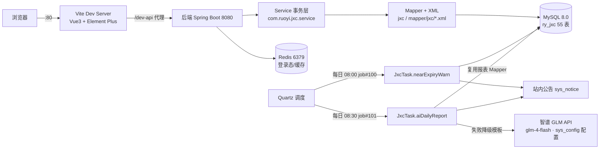

# 多 Agent 协同说明（商超进销存 · 毕设）

> **读者**：将要接管本项目、或与本项目并行开发的 Agent / 模型。
> **目标**：读完这一份，能准确判断「该读哪个文件、能改哪段代码、改完怎么验证、什么不能碰」。
> **生成时间**：2026-10-24 ｜ **实测基线**：26,522 个文件 / 56 张表 / 22 个业务模块 / 8 条事务链（2026-10-24 下午起新增前台收银 + AI 经营日报 + 扫码收款到账广播）
> **最短版**：先看根目录 `AGENTS.md`；本文是它的展开与依据。

---

## 一、阅读顺序（按角色）

| 角色 | 先读 | 再读 | 可改范围 | 交付物 |
|---|---|---|---|---|
| **产品 / 需求** | 本文 §3 模块表 | `docs/项目交接文档.md` 一~三节 | 仅 `docs/**` | PRD/口径文档 |
| **架构** | 本文 §2 架构图、§4 事务链 | `毕设调研与规划设计方案.md` | 设计文档；代码改动需评审 | 设计说明 |
| **后端** | 本文 §3、§4、§5 | `JxcStockCoreMapper.java`、对应 Service | `com.ruoyi.jxc.*` | 接口 + 事务逻辑 |
| **前端** | 本文 §3、§7 | `src/views/jxc/**` 现有页面 | `src/views/jxc/**`、`views/jxcHome` | Vue3 页面 |
| **QA** | 本文 §8 风险 + 验证表 | `docs/项目进度跟踪.md` 第九节验收报告 | 不改源码 | 测试用例/报告 |

**所有角色的共同前提**：`docs/项目进度跟踪.md` 是**进度唯一来源（SSOT）**，任何交付完成后必须更新它的「更新记录」；同时必须在 `docs/会话变更记录.md` 末尾**追加本轮文件级变更记录**（代码/数据库/依赖/验证/待办）——两者缺一不可，完成后再推送 Git。

---

## 二、架构与依赖



**分层事实**（务必遵守，不要跨层调用）：
- Controller 在 `ruoyi-admin` 模块，**Service/domain/mapper 在 `ruoyi-system` 模块**
- 跨模块库存能力统一走 `JxcStockCoreMapper`（upsert / 原子扣减 / 流水 / 应收应付写入），**不要各模块自己写 SQL**
- 定时任务在 `ruoyi-quartz`（该模块**额外依赖了 ruoyi-system**，这是为访问业务 Mapper 做的改造）

---

## 三、核心模块职责（19 个业务页）

> 后端 Controller 实测坐标：`RuoYi-Vue/ruoyi-admin/src/main/java/com/ruoyi/jxc/controller/`（16 个）
> 前端页面：`RuoYi-Vue3/src/views/jxc/`（16 个目录）+ `src/views/jxcHome`（首页）

| # | 页面 | 路由 | Controller | 主要表 | 关键行为 |
|---|---|---|---|---|---|
| 1 | 商品信息 | `/jxc/product` | `JxcProductController` | `jxc_product` | 含批次/效期标记、进价、库存下限 |
| 2 | 商品分类 | `/jxc/category` | `JxcProductCategoryController` | `jxc_product_category` | 树形结构 |
| 3 | 供应商 | `/jxc/supplier` | `JxcSupplierController` | `jxc_supplier` | 应付往来单位 |
| 4 | 会员 | `/jxc/member` | `JxcMemberController` | `jxc_member` | 挂账销售的前置条件 |
| 5 | 采购订单 | `/purchase/purchase_order` | `JxcPurchaseOrderController` | `jxc_purchase_order(+item)` | 主子表；状态 0草稿/2部分/3已执行 |
| 6 | 采购入库 | `/purchase/stock_in` | `JxcStockInController` | `jxc_stock_in(+item)` | **审核即执行**（链①） |
| 7 | 采购退货 | `/purchase/purchase_return` | `JxcPurchaseReturnController` | `jxc_purchase_return(+item)` | 应付红冲（负数台账） |
| 8 | 销售开单 POS | `/sale/sale_order` | `JxcSaleOrderController` | `jxc_sale_order(+item)` | **保存即生效** + FEFO 拆批 |
| 8a | **前台收银** | `/sale/cashier` | `JxcCashierController` | 复用 `jxc_sale_order(+item)` | 扫码/搜索加购 + 找零 + **自动单号**；委托链②，权限独立 `jxc:cashier:*` |
| 9 | 销售退货 | `/sale/sale_return` | `JxcSaleReturnController` | `jxc_sale_return(+item)` | 原批次回增 + 成本还原 |
| 10 | 库存查询 | `/stock/list` | `JxcStockQueryController` | `jxc_stock` | **只读**，含临期/低库存筛选 |
| 11 | 库存流水 | `/stock/stock_flow/list` | `JxcStockQueryController` | `jxc_stock_flow` | **只读**，全链路追溯账本 |
| 12 | 库存盘点 | `/stock/stock_check` | `JxcStockCheckController` | `jxc_stock_check(+item)` → `jxc_stock_in/out` | 盘盈/盘亏自动生成调整单（链④） |
| 13 | 期初导入 | `/stock/init` | `JxcInitController` | `jxc_stock` + `jxc_stock_flow` | Excel 三步导入（链⑥） |
| 14 | 收付款登记 | `/finance/payment` | `JxcFinanceController` | `jxc_payment(+item)` | 一对多核销（链⑤） |
| 15 | 应付台账 | `/finance/*` | `JxcFinanceController` | `jxc_payable` | 余额 = 金额 - 已付 |
| 16 | 应收台账 | `/finance/*` | `JxcFinanceController` | `jxc_receivable` | 会员挂账产生 |
| 17 | 销售统计/畅销榜 | `/report/sale_report` | `JxcReportController` | 聚合 `jxc_sale_order(+item)` | 含毛利（基于成本快照） |
| 18 | 库存预警 | `/report/warning_report` | `JxcReportController` | 聚合 `jxc_stock`/`jxc_product` | 低库存 + 临期 |
| 19 | **AI 经营日报**（无独立页，产出走公告） | — | `JxcTask.aiDailyReport`（job#101） | 复用报表 Mapper + `sys_notice` | 大模型分析 + 失败降级模板；配置在 sys_config `jxc.ai.*` |
| 20 | **扫码收款与到账广播**（收银台内嵌，无独立菜单） | — | `JxcPayController` + `JxcPayBroadcaster`(SSE) | `jxc_pay_notify`（第25张jxc表） | 支付宝沙箱真实回调+验签 / 微信适配层模拟；到账语音播报+自动结算；配置 `jxc.pay.*` |
| — | 首页 | `/index` | — | — | `views/jxcHome`：欢迎 + 7 快捷卡 + 到账播报订阅 |

**25 张 jxc 业务表**（分 6 组）：
- 基础资料 4：`jxc_product`、`jxc_product_category`、`jxc_supplier`、`jxc_member`
- 采购 6：`jxc_purchase_order(+item)`、`jxc_stock_in(+item)`、`jxc_purchase_return(+item)`
- 销售 4：`jxc_sale_order(+item)`、`jxc_sale_return(+item)`
- 库存 6：`jxc_stock`、`jxc_stock_flow`、`jxc_stock_check(+item)`、`jxc_stock_out(+item)`
- 往来 4：`jxc_payable`、`jxc_receivable`、`jxc_payment(+item)`
- 支付 1：`jxc_pay_notify`（到账流水，out_trade_no 唯一键幂等）

---

## 四、8 条事务链（改动风险最高的地方）

| 链 | 触发点 | 事务内步骤 | 涉及表 | 失败即整体回滚 |
|---|---|---|---|---|
| ① 入库联动 | `PUT /jxc/stock_in/audit/{id}` | 现存量 upsert → 流水 → 应付 → 订单 `received_qty` 回写 → 单据 status=1 | stock, stock_flow, payable, purchase_order, stock_in | 重复审核被拒 |
| ② 销售 FEFO | `POST /jxc/sale_order` | 按效期升序拆批 → 逐批**原子扣减** → 流水(负数) → 明细写成本快照 → 应收 | stock, stock_flow, sale_order(+item), receivable | 库存不足（affected=0）整单回滚 |
| ③ 退货红冲 | `PUT /jxc/{purchase,sale}_return/audit/{id}` | 原批次扣减/回增 → 流水 → 应付/应收**负数台账** | 同上对应表 | 超量退货被拒 |
| ④ 盘点调整 | `PUT /jxc/stock_check/audit/{id}` | 盘盈→生成入库单 / 盘亏→生成出库单（`source_type=CHECK`）→ 库存变动 → 流水 → 回写 `gen_in_no/gen_out_no` | stock_check(+item), stock_in/out(+item), stock, stock_flow | 盘亏超库存整单回滚 |
| ⑤ 往来核销 | `POST /jxc/finance/payment` | 逐笔原子 UPDATE(`WHERE balance >= 核销额`) → `paid_amount` 累加 → status 0/1/2 → 核销明细 | payable, receivable, payment(+item) | 超核销拒绝；**SET 求值顺序**是坑 |
| ⑥ 期初建账 | `POST /jxc/init/import` | 校验（6 条规则）→ 写现存量 → `biz_type=INIT, biz_id=0` 流水 | stock, stock_flow | 重复导入被拒 |
| ⑦ 临期预警 | Quartz `job#100` 每日 08:00 | 扫 30 天内到期批次 → 生成公告（幂等） | stock, product, sys_notice | 无数据不打扰 |
| ⑧ 流水追溯 | 全系统 | `jxc_stock_flow` 是唯一账本：现存量 = Σ 流水变动 | stock, stock_flow | 对账 4/4 一致（验收口径） |

> **改这 8 条链的前提**：必须读懂 `JxcStockCoreMapper.java` + `.xml`；改完必须跑 §8 的对应验证。
> 补充（2026-10-24）：**前台收银复用链②**（`JxcCashierController` 委托 `insertJxcSaleOrder`，不改事务逻辑）；**AI 经营日报不在事务链上**（只读查询 + 写公告，失败自动降级）。

---

## 五、关键代码坐标

| 能力 | 文件 |
|---|---|
| 库存核心（upsert/原子扣减/流水/应付应收写入） | `RuoYi-Vue/ruoyi-system/src/main/java/com/ruoyi/jxc/mapper/JxcStockCoreMapper.java`<br>`.../resources/mapper/jxc/JxcStockCoreMapper.xml` |
| 临期预警 + AI 经营日报定时任务 | `RuoYi-Vue/ruoyi-quartz/src/main/java/com/ruoyi/quartz/task/JxcTask.java`（nearExpiryWarn / aiDailyReport，job#100/#101） |
| 大模型 HTTP 客户端（OpenAI 兼容 + Bearer 头） | `RuoYi-Vue/ruoyi-system/src/main/java/com/ruoyi/jxc/util/JxcAiClient.java` |
| 前台收银（商品定位/结算委托） | `RuoYi-Vue/ruoyi-admin/.../jxc/controller/JxcCashierController.java` + `RuoYi-Vue3/src/views/jxc/cashier/index.vue` |
| 扫码收款与到账广播 | `RuoYi-Vue/ruoyi-admin/.../jxc/controller/JxcPayController.java` + `.../jxc/pay/JxcPayBroadcaster.java`（SSE）+ `ruoyi-system/.../jxc/service/impl/JxcPayServiceImpl.java`（沙箱 precreate/验签/幂等） |
| 销售单号自动生成（XS+日期+流水） | `JxcSaleOrderServiceImpl.generateSaleNo`（saleNo 为空时触发，开单页手工单号兼容） |
| 只读库存/流水查询 | `.../jxc/controller/JxcStockQueryController.java` + `JxcStockQueryMapper.xml` |
| 菜单与授权数据 | `sql/jxc_menu_*.sql`（10 个），运行时以 `sys_menu` 为准 |
| 前端首页（改造后） | `RuoYi-Vue3/src/views/jxcHome/index.vue` |
| 前端品牌/标题 | `.env.*` 的 `VITE_APP_TITLE`；侧边栏 `src/layout/components/Sidebar/Logo.vue` |

---

## 六、中间件与产物清单（迁移必读）

> 迁移已把这些产物**一并带到** `D:\Graduation_project`，无需重新下载/安装。逐项说明用途、来源、用法与注意事项。

| # | 产物 | 体积 | 用途 | 来源 / 版本 | 使用方式 | 注意事项 |
|---|---|---|---|---|---|---|
| 1 | `redis/` | 47 MB | 登录 token、验证码、缓存 | Windows 免安装 Redis **5.0.14.1**（16 个文件） | `redis-server.exe --port 6379`；`redis-cli.exe ping` 验证 | **无 rdb/aof 持久化**，重启即清空 → 用户需重登；业务数据全在 MySQL，不受影响；机器重启需手动启动；**必须先于后端启动** |
| 2 | `RuoYi-Vue/*/target/` + `ruoyi-admin.jar` | ~89 MB | 可执行后端（fat jar 含依赖与配置） | `mvn package -DskipTests`（2026-10-15 18:20 构建） | `env -u SERVER__PORT java -jar ruoyi-admin.jar --server.port=8080` | **jar 文件锁**：重新构建前必须停 8080；**配置（application*.yml）已打进 jar**，改配置必须重打包或用 `--spring.config.location` 外置 |
| 3 | `RuoYi-Vue3/node_modules/` | 244 MB / 24.5k 文件 | 前端依赖 | `npm install`（**无 package-lock.json**） | `npm run dev` / `npm run build:prod` | 版本未锁定，重装可能漂移（Vue3.5/Vite6/EP2.13 均为区间）；换目录后 **必须删 `node_modules/.vite`**（含绝对路径缓存） |
| 4 | `RuoYi-Vue3/dist/` | 7.3 MB | 生产前端包（含 `.gz`） | `npm run build:prod`（约 23s） | 交给 Nginx/Apache 静态托管 | 需把 `/prod-api` 反代到后端 8080；开发环境不用它（用 Vite dev） |
| 5 | `backup/ry_jxc_20261024.sql` | 237 KB | **数据库全量快照（55 表）** | 本次 `mysqldump --databases --single-transaction --routines --triggers` | `mysql -u root -p < backup/ry_jxc_20261024.sql` | 含 `CREATE DATABASE`/`USE`，恢复会**覆盖同名库**；含 sys 操作日志/qrtz 状态/gen 配置（`sql/` 脚本里没有这些）；先在测试库验证再上生产 |
| 6 | `sql/`（13 个脚本） | 116 KB | 建表 + 演示数据 + 菜单授权 | 开发期产出 | 按 `jxc_schema.sql` → `jxc_data_init.sql` → `jxc_menu_*.sql` 顺序执行 | **只能用于从零重建**；不要在生产库重复执行菜单脚本（会重复插入菜单） |
| 7 | `D:\ruoyi\uploadPath` | 52 KB | 用户头像、上传附件 | 运行时上传（`application.yml` 的 `profile`） | 后端自动读写，无需手动操作 | **在项目目录之外**，只复制项目会漏；换盘才需改 `profile` |
| 8 | `D:\home\ruoyi\logs` | 497 KB | 业务日志（info/error，按日滚动） | logback `log.path=/home/ruoyi/logs` | 直接看 `sys-error.log` 排障 | 路径**无盘符**，跟随当前盘（D: 下即 `D:\home\ruoyi\logs`）；不入库不入 Git |
| 9 | `codegen/` | 848 KB | 代码生成器输出留档（11 目录 + 11 zip） | RuoYi 代码生成器 | 参考已生成结构 | `*.zip` 与解压目录内容重复，属冗余中间产物 |
| 10 | `repo/` | 13 MB | **Git 仓库（唯一本地副本）** | 与 `git@github.com:lhw5207/My_GP.git` 同源同步 | `git -C repo status` / `git log -1` | ⚠️ 旧备份镜像 `E:\Git` 已于 2026-10-26 删除（R6/R7），不要再引用；一切提交走 `repo/`，推送前先 `git pull --rebase` |
| 11 | `AGENTS.md` + 本文 | — | Agent 上手说明 | 本次产出 | 直接读 | 根目录 `AGENTS.md` **不在 Git 仓库内**（repo 只含 backend/frontend/docs/sql） |

---

## 七、修改边界与禁区

### ✅ 可自由修改
- 后端：`ruoyi-admin/.../jxc/controller/**`、`ruoyi-system/.../jxc/{domain,mapper,service,service/impl}/**`、`resources/mapper/jxc/*.xml`
- 前端：`src/views/jxc/**`、`src/views/jxcHome/**`、`src/api/jxc/**`
- 文档：`docs/**`、根目录说明类 md

### ⚠️ 改动前必须先说明理由
| 对象 | 为什么 |
|---|---|
| `JxcStockCoreMapper.java/.xml` | 被 8 条链复用，改错会同时击穿库存与往来 |
| `ruoyi-framework/**` | 基座安全/数据权限/拦截器，改错全站登录失效 |
| `sys_menu` 数据（`sql/jxc_menu_*.sql` 或 DB） | 菜单即权限来源，删了角色授权失效 |
| `application*.yml` | 配置打包进 jar；改后必须重打包 |
| `pom.xml` / `package.json` 依赖 | 后端锁 JDK8，前端无 lock，升级易连锁崩 |

### ❌ 禁止修改
1. `RuoYi-Vue3/src/utils/*`、`src/permission.js`、`src/store/**`、`src/request.js` —— 基座鉴权/请求链路
2. **已审/已生效单据的"禁止改删"拦截逻辑** —— 审计合规底线（纠错只能走退货/红冲）
3. 事务链的**事务边界**（`@Transactional` 方法内不得引入远程调用/异步）
4. `ruoyi-admin/target/**`、`dist/**`、`node_modules/**` 内的手改 —— 重新构建即丢失

---

## 八、风险清单与验证方式

| # | 风险 | 触发场景 | 验证方式（可执行） |
|---|---|---|---|
| 1 | 库存与流水不一致 | 改了扣减/回增逻辑 | 对账：每个 `product_id+batch_no`，`jxc_stock.quantity` 应等于 `SUM(jxc_stock_flow.change_qty)`；期望 4/4 一致 |
| 2 | 超卖 / 负库存 | 去掉原子条件 | 并发或超量开单应返回"库存不足"，且整单回滚（流水/单据零残留） |
| 3 | 核销把部分收款判成已核销 | 改动核销 UPDATE 的 SET 顺序 | 部分核销后 `status` 应为 1；`amount = paid_amount + balance` 必须成立 |
| 4 | 已审单被改删 | 新增接口未加状态校验 | 对已审单据调 update/delete 应被拒 |
| 5 | 配置改了没生效 | 只改 yml 未重打包 | `java -jar` 启动后看日志实际端口/数据源；或改完 `mvn package` |
| 6 | 前端白屏/模块解析失败 | 换目录后残留 `.vite` | 删 `node_modules/.vite` 重跑 `npm run dev` |
| 7 | 端口起在 9514/3827 等怪端口 | 未清 `SERVER__PORT` | 启动后 `netstat` 查 8080 是否 LISTENING |
| 8 | 恢复 dump 覆盖现库 | 直接 `mysql < backup.sql` | 先在临时库 `ry_jxc_test` 恢复并核对 55 表 |

**通用验证脚本**（改完任何后端事务逻辑都跑一遍）：
```bash
curl -s -o /dev/null -w 'captcha=%{http_code}\n' --noproxy '*' http://localhost:8080/captchaImage
TOKEN=$(curl -s --noproxy '*' -X POST http://localhost:8080/login -H "Content-Type: application/json" \
  -d '{"username":"admin","password":"admin123"}' | sed -n 's/.*"token":"\([^"]*\)".*/\1/p')
curl -s --noproxy '*' -H "Authorization: Bearer $TOKEN" "http://localhost:8080/jxc/stock/list?pageNum=1&pageSize=5" | grep -o '"total":[0-9]*'
curl -s --noproxy '*' -H "Authorization: Bearer $TOKEN" "http://localhost:8080/jxc/finance/payable/list?pageNum=1&pageSize=5" | head -c 120
```

---

## 九、并发协作约定（多 Agent 并行时）

1. **事务层单写者**：同一时刻只允许 1 个 Agent 修改 `JxcStockCoreMapper` / 库存·往来相关 Service，其余 Agent 只读。
2. **文件级分区**：前端 Agent 只碰 `src/views/jxc/**` 与 `src/api/jxc/**`；文档 Agent 只碰 `docs/**`；后端 Agent 只碰 `com.ruoyi.jxc.*`。三者可并行。
3. **提交粒度**：一次改动 = 一个语义提交；提交信息格式 `type(scope): 描述`（`feat/fix/docs/refactor`），**消息内不要用英文双引号**。
4. **提交前必做**：`git -C repo pull --rebase` → 更新 `docs/项目进度跟踪.md` → `docs/会话变更记录.md` 追加本轮变更记录 → 跑 §8 验证。
5. **仓库唯一性**：`repo/` 是**唯一本地 Git 工作副本**（旧备份镜像 `E:\Git` 已于 2026-10-26 经用户确认删除，其内容 6255dce 为远程历史祖先、无独有数据）；所有提交只走 `repo/`。
6. **禁止静默改基座**：任何 `ruoyi-framework`、`src/utils`、`permission.js` 的改动，必须先在对话里说明原因与影响面。

---

## 十、新 Agent 开场提示词（复制即用）

```text
【项目】中小型商超进销存管理系统（毕设），路径 D:\Graduation_project。
请先读：1) AGENTS.md  2) docs/多Agent协同说明.md  3) docs/项目进度跟踪.md  4) docs/项目交接文档.md

【硬约束】
- 后端 RuoYi-Vue 3.9.1 + JDK8（勿升 3.9.2+）；前端 RuoYi-Vue3；库 ry_jxc；Redis 6379
- 启动顺序 Redis → 后端(8080) → 前端(80)；后端必须 env -u SERVER__PORT + --server.port=8080
- 构建前先停 8080（jar 锁）；curl 必须加 --noproxy '*'
- 只改 com.ruoyi.jxc.* 与 src/views/jxc/**；禁改 src/utils、permission.js、已审单拦截逻辑
- 改完跑 6 项验证，并更新 docs/项目进度跟踪.md，然后同步 repo/ 并 push

【本次任务】<在此填写>
```

---

*文档结束 · 基线数据为 2026-10-24 实测；结构或版本变更后请同步更新本文件与 AGENTS.md*
